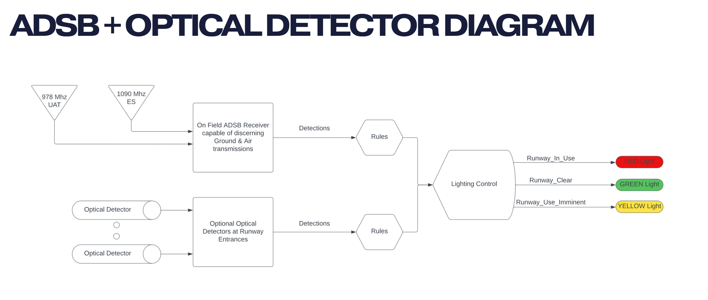
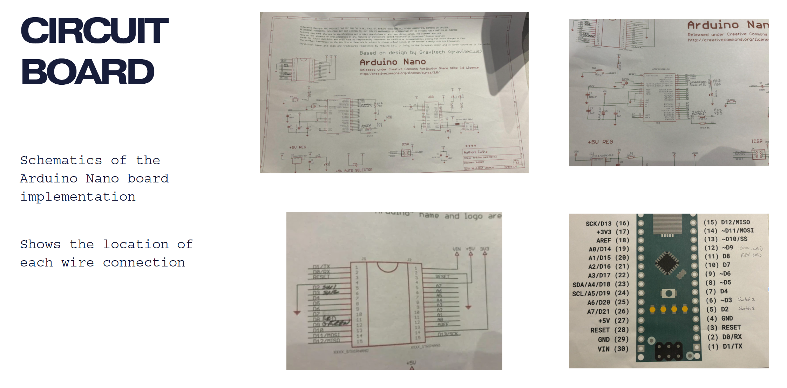

# Runway Lights: Airport Runway Incursion Prevention System

**Course:** ENGR 408 – Engineering Leadership Principles  
**Competition:** Airport Cooperative Research Program (ACRP) Design Competition  
**Role:** Prototype Lead  
**Technologies:** Python | Turtle Graphics | Object-Oriented Programming

---

## Project Overview

Runway Lights is an engineering design project developed for the Airport Cooperative Research Program (ACRP) Design Competition as part of ENGR 408: Engineering Leadership Principles.

The project focused on improving airport runway safety by developing a technology-driven system designed to detect aircraft and ground vehicle activity and communicate runway status through automated visual lighting alerts.

Our proposed solution combined Automatic Dependent Surveillance–Broadcast (ADS-B) aircraft tracking with optical vehicle detection to identify potential runway conflicts and provide pilots and airport ground personnel with improved situational awareness.

As the **Prototype Lead**, I guided the team through the prototyping process and helped translate our proposed engineering solution into functional Python simulations.

## Problem Statement

Runway incursions occur when aircraft, vehicles, or personnel enter or occupy a runway or its protected area without authorization, creating potentially dangerous situations.

Through interviews with pilots, engineers, and aviation industry professionals, we identified several recurring challenges:

- Limited situational awareness at airports without air traffic control towers.
- Difficulty navigating runway environments without active ATC guidance.
- Frequent and potentially dangerous runway incursions.
- The need for an accessible, practical solution to improve runway awareness.

Our objective was to develop a system that could improve communication between aircraft and ground operations while reducing the likelihood of runway incursions.

## Research & User Interviews

Our team interviewed engineers, pilots, and aviation professionals to better understand runway safety challenges and identify opportunities for improvement.

Interviewees highlighted the hazards of landing at non-towered airports and the difficulties associated with navigating runways without air traffic control guidance.

These conversations reinforced the importance of developing an automated solution capable of identifying runway activity and communicating potential conflicts before they become safety hazards.

## Proposed Solution

We designed a conceptual runway monitoring system that integrates two detection technologies with automated lighting controls.

### 1. ADS-B Aircraft Detection

- Receive aircraft transmissions through on-field ADS-B equipment.
- Evaluate aircraft information, including altitude and distance.
- Apply predefined parameters to identify aircraft approaching the runway.
- Generate alerts based on aircraft proximity.

### 2. Optical Vehicle Detection

- Use optical detectors to identify vehicles entering or occupying the runway.
- Monitor ground vehicle activity.
- Incorporate vehicle detection into runway occupancy decisions.
- Identify potential conflicts between aircraft and ground operations.

### 3. Automated Runway Lighting

A central computer processes aircraft and vehicle detection information and applies predefined decision logic to determine runway status.

The system generates control tokens that trigger the appropriate visual lighting response.

| Light Status | Meaning |
|---|---|
| Red | Runway occupied |
| Yellow | Potential conflict or imminent activity |
| Green | Runway clear |

### System Architecture

```text
      ADS-B Aircraft Transmissions
                   |
                   v
         Aircraft Information
                   |
                   |
       Optical Vehicle Detection
                   |
                   v
          Central Processing
                   |
                   v
            Decision Logic
                   |
                   v
             Control Tokens
                   |
                   v
          Automated Runway Lights
                   |
          +--------+--------+
          |        |        |
          v        v        v
         RED     YELLOW    GREEN
       Occupied  Imminent  Clear
```

## Python Prototype & Implementation

To demonstrate the proposed system, our team developed Python simulations using Turtle Graphics.

The prototype focused on two primary components:

### Aircraft Proximity Alert Simulation

The ADS-B simulation demonstrated how aircraft information could be evaluated against predefined safety parameters.

Key functionality:
- Accepted aircraft altitude and distance inputs.
- Evaluated aircraft information against predefined thresholds.
- Generated alert states based on aircraft proximity.
- Prioritized runway-related alerts.

### Runway Occupancy Controller

The optical detection simulation demonstrated how runway occupancy could be monitored and controlled.

Key functionality:
- Implemented an object-oriented `RunwayController` class.
- Tracked runway occupancy through state management.
- Simulated vehicle entry and exit events.
- Triggered visual red and green runway status indicators.
- Prevented invalid runway entry and exit state transitions.

Together, these simulations demonstrated the foundational decision-making and control logic behind the proposed runway safety system.

## Project Screenshots

The images below document the project's progression from early design concepts to the completed physical prototype, including the system architecture, circuit layout, and supporting code.

### System Design & Architecture

**System diagram**



**Runway design diagram**


### Prototype Development

**Low-fidelity prototype**


**Completed runway prototype**


**Rear view of the completed prototype**


**Circuit board**



### Code & Implementation

**Prototype code**


[View the full Screenshots folder](Screenshots/)

## My Role: Prototype Lead

As Prototype Lead, I helped guide the team through the prototyping process and translate our engineering concept into a working demonstration.

My contributions included:

- Leading and coordinating the team's prototyping efforts.
- Guiding teammates through prototype development.
- Translating the proposed system architecture into executable logic.
- Contributing to Python development and runway lighting simulations.
- Supporting iterative testing and refinement of the prototype.
- Helping connect the technical implementation to the overall engineering design objectives.

## Technical Skills Demonstrated

| Category | Skills |
|---|---|
| Programming | Python |
| Software Development | Object-Oriented Programming, Functions, Conditional Logic |
| Simulation | Turtle Graphics, State Management |
| Systems Engineering | Detection Logic, Control Systems Concepts |
| Research | Stakeholder Interviews, Problem Definition |
| Leadership | Technical Leadership, Prototype Development, Team Collaboration |

## Future Development Opportunities

Potential enhancements to the proposed system include:

- Integrating live ADS-B data feeds.
- Incorporating physical optical vehicle detection sensors.
- Combining aircraft and vehicle detection into a unified monitoring system.
- Developing a real-time runway monitoring interface.
- Testing the system against simulated runway conflict scenarios.

---

**Disclaimer:** This project was developed as an academic engineering prototype and conceptual safety system. It is not a certified or operational aviation safety solution.

**Project Focus:** Aviation Safety | Engineering Design | Python Development | Systems Prototyping | Technical Leadership
